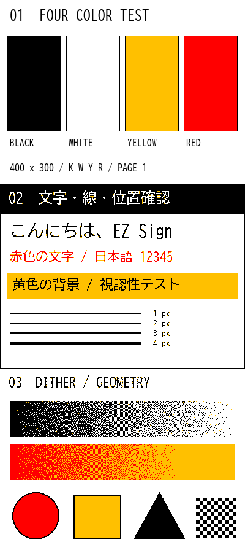

[[Japanese](README.md)/[English](README_EN.md)]

# ezsign-se0420b1-python

[Santek EZ Sign USBタイプ・4.2インチ・4色表示（SE0420B1）](https://santekdisplay.com/pages/ez-door-sign-4-color-type-support)をPythonから操作する非公式ライブラリです。<br>
画像の書き込み・読み出し、保存済みページの切り替え、USBシリアルポートの自動検索に対応します。



# Features

- USBポートを自動検索し、機種識別に応答する4色モデルに接続します
- 最大5ページの画像を保存し、指定ページ・次・前に切り替えられます
- 入力画像を縦横比を維持した400×300・黒/白/黄/赤の4色画像に変換します
- 透過画像の白背景合成、写真向けのディザリングに対応します
- CLIとPython APIの両方から利用できます
- 定期通信による電源ON状態の維持に対応します（初回の電源ONは手動）

# Purpose of This Repository

SE0420B1のUSB通信をPythonから利用し、案内表示や保存済み画像の切り替えに使うためのリポジトリです。<br>
3色モデルやNFCタイプは対象外です。メーカー公式のSDKではありません。

# Requirements

```text
Python    3.12 or later
pyserial  >=3.5,<4
pillow    >=11,<14
pytest    >=8,<10   # テスト用
```

実機はWindowsで動作確認しています。USBシリアル通信を使う構成ですが、Linux/macOSでの実機動作は未確認です。<br>
本体・データ通信対応のUSBケーブル・本体を認識するUSBシリアルドライバーが必要です。

# Installation

このリポジトリからインストールする場合は次のように実行します。

```bash
uv add git+https://github.com/Kazuhito00/ezsign-se0420b1-python.git

# pipの場合
pip install git+https://github.com/Kazuhito00/ezsign-se0420b1-python.git
```

開発する場合はクローンし、uvで環境を構築してください。

```bash
git clone https://github.com/Kazuhito00/ezsign-se0420b1-python.git
cd ezsign-se0420b1-python
uv sync --locked
```

以降のコマンド例はクローンしたリポジトリ内での実行を想定し、`uv run` 付きで記載しています。<br>
配布パッケージ名は `ezsign-usb`、Pythonのインポート名は `ezsign_usb`、CLI名は `ezsign` です。

# Usage

### Quick Start

本体側面のボタンを2〜3秒長押しして電源をONにします。LEDは通常青、充電中は紫、充電完了時は水色です。<br>
緑は充電完了・電源OFFです。公式アプリなど、同じポートを使用するソフトは終了してください。

```bash
# 自動検索と機種識別（画像は変更しません）
uv run ezsign list --probe
uv run ezsign identify

# 上書き前に現在の画像を保存
uv run ezsign read backup-page1.png --page 1

# 同梱のテスト画像をページ1に書き込んで表示
uv run ezsign write assets/test-images/01-colors.png --page 1
```

ページ番号は1〜5です。`write` は指定ページの画像を上書きします。<br>
通常はCOM番号の指定は不要です。複数台接続時は `--port COM4` のように対象を指定してください。

### CLI

```bash
# 実機に接続せず変換結果を確認
uv run ezsign preview input.png preview.png --dither

# 画像を転送して表示
uv run ezsign write input.png --page 2 --dither

# 保存済み画像に切り替え
uv run ezsign show --page 1

# 60秒ごとに通信し、1時間電源を維持
uv run ezsign keep-awake --duration 3600

# 30秒間隔を指定する場合
uv run ezsign keep-awake --duration 3600 --interval 30

uv run ezsign --help
uv run python -m ezsign_usb --help
```

| コマンド | 内容 |
|---|---|
| `list [--probe]` | 候補を列挙。`--probe` で機種識別も実行 |
| `identify` | 製品IDを確認 |
| `preview INPUT OUTPUT [--dither]` | 400×300・4色の画像を生成 |
| `read OUTPUT --page N` | 保存済みページを読み出し |
| `write INPUT --page N` | 画像を転送し、表示更新を要求 |
| `show --page N` | 保存済みページを表示 |
| `keep-awake --duration SECONDS` | 定期通信で電源ON状態を維持 |

機器を操作するコマンドは `--port` を省略すると自動検索します。<br>
`write --no-refresh` は転送のみです。`write` / `show` の `--wait` は更新後の待機秒数（既定20秒）で、描画完了を検出する機能ではありません。

### Python

```python
from ezsign_usb import EZSign, discover, prepare_image

print(discover())
prepare_image("input.png", dither=True).save("preview.png")

with EZSign() as display:  # USBポートを自動検索
    print(display.port)
    display.read_image(1).save("backup-page1.png")
    display.write_image(1, "input.png")
    display.show_page(2)
    display.show_page(EZSign.NEXT)
    display.keep_awake(duration=3600, interval=60)
```

Pillowの `Image` も `write_image` に渡せます。`EZSign("COM4")` のようなポート指定も可能です。<br>
`with` を抜けると接続を閉じます。操作は同期的で、同じ接続への呼び出しは直列に実行してください。<br>
API一覧・引数・例外は [docs/api.md](docs/api.md) を参照してください。

### Demo

4色・文字・細線・ディザリングを確認する画像を生成します。画像生成だけなら実機は不要です。

```bash
uv run python examples/demo_test_images.py
```

生成先は `output/image-test-日時/` です。`--write` を付けると、実機のページ1〜3をバックアップしてから上書きし、読み戻して一致を確認します。

```bash
uv run python examples/demo_test_images.py --write
```

# Test

```bash
uv run pytest
uv build
```

実機を使用しない19件のテストで、画像形式・パケット・異常応答・自動検索・転送境界・電源維持の待機間隔を確認しています。<br>
Windowsの実機では3ページの書き込みと読み戻しの完全一致、合計1時間の識別通信を確認しました。<br>
1時間試験の途中で通信間隔を5秒から60秒に変更しており、60秒間隔の区間は42分5秒です。

実機の検証範囲は [docs/hardware-validation.md](docs/hardware-validation.md)、通信仕様は [docs/protocol.md](docs/protocol.md) にまとめています。

識別通信だけのログ付き試験は次で実行できます。画像は変更しません。

```bash
uv run python tools/check_keepalive.py --duration 3600 --interval 60
```

# Limitations

- SE0420B1専用です。USBチップが同じ別機器も接続候補になり得るため、接続時に製品IDを確認します
- 無操作で約2〜3分後に自動OFFになります。電源OFFからの起動や、自動OFF設定の無効化には対応していません
- `keep_awake` は指定時間待機する処理です。別スレッドで自動的に電源維持する機能ではありません
- 画面更新には時間がかかります。数分以上の間隔で表示を切り替える用途を想定してください
- 自動再接続や表示スケジューラーは実装していません
- 書き込み途中のエラーで画像の一部が更新される場合があります。原因を解消して画像全体を再転送してください
- 黄のプレビュー値はRGB `(255,192,0)` です。実機の色味・視認性の目視検証は含んでいません

# Project Structure

```text
README.md                   # 日本語
README_EN.md                # English
LICENSE                     # MIT
pyproject.toml              # パッケージ定義
uv.lock                     # uvの依存関係
src/ezsign_usb/
  device.py                 # 自動検索・ページ操作・電源維持
  images.py                 # 4色変換・2bppエンコード
  protocol.py               # パケット・応答検証・例外
  cli.py                    # CLI
examples/demo_test_images.py # 画像生成・実機転送デモ
assets/test-images/          # 診断用サンプル画像
tools/check_keepalive.py     # ログ付き電源維持試験
tests/                      # 実機不要のテスト
docs/                       # API・通信仕様・検証範囲
```

# Reference

- [kenichi884/ezsign.py](https://github.com/kenichi884/ezsign.py): 3色モデル向けの参考実装。フレーム構造・チェックサム・ブロック転送・ページ操作の手順を参考にしています
- [Santek SE0420B1 サポート](https://santekdisplay.com/pages/ez-door-sign-4-color-type-support): 製品情報・説明書・公式アプリ
- 4色形式と機種識別はメーカー配布アプリ `EZ Sign 1.2.6.0-x86` の通信・画像変換処理と照合しました。公式アプリ・インストーラーは同梱していません

# Author

高橋かずひと(https://x.com/KzhtTkhs)

# License

ezsign-se0420b1-python is under [MIT License](LICENSE).
