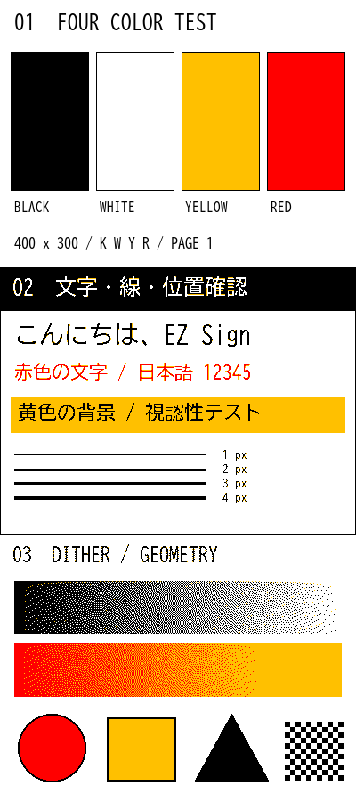

[[Japanese](README.md)/[English](README_EN.md)]

# ezsign-se0420b1-python

An unofficial Python library for the [Santek EZ Sign USB 4.2-inch four-color display (SE0420B1)](https://santekdisplay.com/pages/ez-door-sign-4-color-type-support).<br>
Read and write images, switch stored pages, and discover the USB serial port automatically.



# Features

- Automatically discovers serial candidates and verifies the four-color product identity
- Reads and writes up to five stored pages and switches to a specified, next, or previous page
- Converts images to 400×300 black/white/yellow/red while preserving aspect ratio
- Supports white compositing for transparency and optional dithering
- Provides a CLI and a Python API
- Keeps an already powered-on device awake through periodic communication

# Purpose of This Repository

Use the SE0420B1 USB interface from Python for information displays and switching stored images.<br>
Three-color and NFC models are outside the scope of this project. This is not an official manufacturer SDK.

# Requirements

```text
Python    3.12 or later
pyserial  >=3.5,<4
pillow    >=11,<14
pytest    >=8,<10   # tests only
```

Hardware operation has been verified on Windows. Linux/macOS hardware operation is untested.<br>
A display, a USB data cable, and a working USB serial driver are required.

# Installation

Install directly from this repository:

```bash
uv add git+https://github.com/Kazuhito00/ezsign-se0420b1-python.git

# With pip
pip install git+https://github.com/Kazuhito00/ezsign-se0420b1-python.git
```

For development, clone the repository and use uv:

```bash
git clone https://github.com/Kazuhito00/ezsign-se0420b1-python.git
cd ezsign-se0420b1-python
uv sync --locked
```

The examples below run from the cloned repository using `uv run`.<br>
The distribution name is `ezsign-usb`, the import name is `ezsign_usb`, and the CLI is `ezsign`.

# Usage

### Quick Start

Hold the side button for 2–3 seconds to turn the display on. The LED is normally blue, purple while charging, or light blue when fully charged.<br>
Green indicates fully charged with the display powered off. Close other applications that may use the port.

```bash
# Discover and verify the device without changing an image
uv run ezsign list --probe
uv run ezsign identify

# Back up the existing image before overwriting it
uv run ezsign read backup-page1.png --page 1

# Write and show an included test image
uv run ezsign write assets/test-images/01-colors.png --page 1
```

Pages are numbered 1–5. `write` overwrites the selected page.<br>
Ports are discovered automatically. Use `--port COM4`, for example, to select a device when multiple displays are connected.

### CLI

```bash
uv run ezsign preview input.png preview.png --dither
uv run ezsign write input.png --page 2 --dither
uv run ezsign show --page 1
uv run ezsign keep-awake --duration 3600
uv run ezsign keep-awake --duration 3600 --interval 30
uv run ezsign --help
uv run python -m ezsign_usb --help
```

| Command | Description |
|---|---|
| `list [--probe]` | List candidates; optionally verify their identity |
| `identify` | Query the product identity |
| `preview INPUT OUTPUT [--dither]` | Generate a 400×300 four-color image |
| `read OUTPUT --page N` | Read a stored page |
| `write INPUT --page N` | Transfer an image and request a refresh |
| `show --page N` | Display a stored page |
| `keep-awake --duration SECONDS` | Periodically query identity to keep power on |

Commands that access hardware discover the port when `--port` is omitted.<br>
`write --no-refresh` transfers without refreshing. `--wait` for `write` and `show` is a fixed delay after the refresh request (20 seconds by default), not a rendering-completion check.

### Python

```python
from ezsign_usb import EZSign, discover, prepare_image

print(discover())
prepare_image("input.png", dither=True).save("preview.png")

with EZSign() as display:
    print(display.port)
    display.read_image(1).save("backup-page1.png")
    display.write_image(1, "input.png")
    display.show_page(2)
    display.show_page(EZSign.NEXT)
    display.keep_awake(duration=3600, interval=60)
```

`write_image` also accepts a Pillow `Image`. An explicit port can be passed as `EZSign("COM4")`.<br>
The context manager closes the port. Operations are synchronous; use one connection sequentially.<br>
See [docs/api.md](docs/api.md) for complete signatures and exceptions (Japanese).

### Demo

Generate color, text, fine-line, and dithering patterns without connecting hardware:

```bash
uv run python examples/demo_test_images.py
```

Images are saved to `output/image-test-TIMESTAMP/`. Add `--write` to back up pages 1–3, overwrite them, and verify the readback:

```bash
uv run python examples/demo_test_images.py --write
```

# Test

```bash
uv run pytest
uv build
```

The 19 hardware-independent tests cover image encoding, framing, malformed responses, discovery, transfer boundaries, and keep-awake timing.<br>
Windows hardware testing verified three page transfers by exact readback comparison and one hour of identity responses.<br>
The one-hour test changed from 5-second polling to 60-second polling partway through; the 60-second phase lasted 42 minutes 5 seconds.

See [hardware validation](docs/hardware-validation.md) and [protocol notes](docs/protocol.md) (Japanese).

To log an identity-only endurance test without modifying images:

```bash
uv run python tools/check_keepalive.py --duration 3600 --interval 60
```

# Limitations

- Only the SE0420B1 four-color USB model is targeted. Discovery verifies identity because unrelated devices may share the same USB serial chip
- The device powers off after approximately 2–3 idle minutes. Software power-on and disabling the hardware timeout are not supported
- `keep_awake` blocks for the requested duration; it is not a background service
- E-paper refreshes take time. Use switching intervals of several minutes or longer
- Automatic reconnection and scheduling are not implemented
- A failed write may leave a partially updated page. Resolve the error and transfer the entire image again
- Preview yellow is RGB `(255,192,0)`. Physical color appearance and readability were not visually verified

# Project Structure

```text
README.md                   # Japanese
README_EN.md                # English
LICENSE                     # MIT
pyproject.toml              # Package definition
uv.lock                     # Locked dependencies
src/ezsign_usb/
  device.py                 # Discovery, page operations, keep-awake
  images.py                 # Color conversion and 2bpp encoding
  protocol.py               # Frames, validation, exceptions
  cli.py                    # Command-line interface
examples/demo_test_images.py # Image generation and hardware demo
assets/test-images/          # Diagnostic sample images
tools/check_keepalive.py     # Logged endurance test
tests/                      # Hardware-independent tests
docs/                       # API, protocol, validation scope
```

# Reference

- [kenichi884/ezsign.py](https://github.com/kenichi884/ezsign.py): three-color reference implementation used to understand framing, checksums, block transfers, and page operations
- [Santek SE0420B1 support](https://santekdisplay.com/pages/ez-door-sign-4-color-type-support): product information, manuals, and the official application
- Four-color encoding and identification were checked against the manufacturer's `EZ Sign 1.2.6.0-x86` application. The application and its installer are not distributed here

# Author

Kazuhito Takahashi (https://x.com/KzhtTkhs)

# License

ezsign-se0420b1-python is under the [MIT License](LICENSE).
